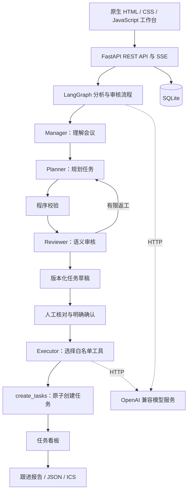

# 序会 · Meeting Studio

基于多 Agent 协作的会议与任务管理工作台，将会议纪要转化为可审核、可执行、可追踪的行动计划。

序会使用 FastAPI、LangGraph 和原生 JavaScript 构建。通过 OpenAI 兼容 HTTP 接口连接大模型，无需在应用环境中安装推理框架；前端由后端直接托管，无需 Node.js 构建或外部 CDN。

```text
会议纪要 → 议题提取 → 任务规划 → 审核与人工确认 → 任务看板 → 跟进与导出
```

## 功能

- **会议输入与归档**：支持粘贴文本、拖拽上传 TXT / 文本型 PDF，保存会议日期、时区、参会人员及带编号的原文段落。
- **四角色协作**：Manager 提取会议议题，Planner 拆解任务，Reviewer 检查内容，Executor 调用本地工具创建正式任务。
- **可追溯的草稿审核**：任务关联原文依据；支持表单编辑、版本历史、重新复核和逐项附理由处理审核意见。
- **执行前人工确认**：草稿通过审核后仍需明确确认；未知负责人和日期可保留为空，人工补充需要记录说明。
- **实时运行进度**：后台队列、SSE 事件流、断线补读、失败重试及重启中断识别。
- **任务看板与跟进**：按负责人筛选任务、更新执行状态，按会议时区统计待办、今日到期与逾期事项。
- **JSON / ICS 导出**：下载会议与任务快照，或将明确截止日期导出为全天日历事件。
- **本地持久化与诊断**：SQLite 保存业务数据，模型及接口测试可保留中间产物，便于排查问题。

## 架构



| 层级 | 技术与职责 |
|---|---|
| 前端 | 原生 HTML、CSS、ES modules、Fetch、EventSource |
| 接口 | FastAPI、Pydantic、REST、SSE |
| 协作流程 | LangGraph、角色提示、程序校验、有限返工 |
| 模型连接 | HTTPX、结构化输出校验、超时与有限重试 |
| 数据存储 | SQLite、WAL、事务、数据库版本迁移 |
| 文档与导出 | pypdf、JSON、RFC 5545 ICS |

模型服务独立部署。应用不依赖 CUDA 或 DCU 运行时；切换 NVIDIA / 海光 DCU 服务时，主要调整模型地址、模型名称与鉴权，并验证目标接口兼容性。

### Agent 编排与配置位置

Agent 编排通过 Python 代码定义，入口是 [app/workflows/analysis.py](app/workflows/analysis.py) 中的 `build_analysis_graph()`。当前分析流程为 `Manager → Planner → Reviewer`；Reviewer 根据审核结果和返工次数决定返回 Planner 或结束。Executor 在用户确认草稿后，由独立执行服务调用。

| 调整内容 | 文件位置 | 说明 |
|---|---|---|
| 节点、执行顺序与返工条件 | [app/workflows/analysis.py](app/workflows/analysis.py) | LangGraph 状态、节点、边及条件路由 |
| Manager / Planner / Reviewer 提示词 | [app/agents/prompts.py](app/agents/prompts.py) | 角色职责、输出要求和提示词版本 |
| 三个分析角色的模型调用 | [app/agents/meeting.py](app/agents/meeting.py) | 各角色的输入上下文、输出契约及结构化调用 |
| Executor 提示词与工具选择 | [app/agents/executor.py](app/agents/executor.py) | 执行角色提示词、工具调用输出契约 |
| 分析与执行服务 | [app/services/planning.py](app/services/planning.py)、[app/services/execution.py](app/services/execution.py) | 工作流调用、时间预算、状态持久化与执行确认 |
| 工具注册机制 | [app/tools/registry.py](app/tools/registry.py) | 工具白名单、参数校验与服务端上下文绑定 |
| 运行参数 | [.env.example](.env.example)、[app/core/config.py](app/core/config.py) | 将模板复制为 `.env` 后配置；默认值及校验规则在 `Settings` 中定义 |

调整模型地址、模型名称、返工上限或超时时，修改 `.env` 中的 `PM_LLM_BASE_URL`、`PM_LLM_MODEL`、`PM_MAX_REVISIONS`、`PM_WORKFLOW_TIMEOUT` 等参数；调整协作顺序或角色行为时，修改对应 Python 文件。修改后需重启应用生效。

## 快速开始

### 环境要求

- Python 3.10 或以上；当前验证环境为 Python 3.10。
- 可访问的 OpenAI 兼容模型服务，提供 `/v1/models` 和 `/v1/chat/completions`。
- 较新的 Chrome、Edge、Firefox 或 Safari 浏览器。
- Node.js 18 或以上仅用于前端自动测试，运行应用不需要 Node.js。

在包含 `requirements.txt` 的项目根目录执行。以下命令用于自行准备环境；已有环境可直接使用。

```bash
conda create -n demo1 python=3.10 -y
conda activate demo1
python -m pip install -r requirements.txt
cp .env.example .env
```

编辑 `.env`，配置模型服务：

```dotenv
PM_LLM_BASE_URL=http://127.0.0.1:8000/v1
PM_LLM_MODEL=qwen3-8b
PM_LLM_API_KEY=EMPTY
```

`PM_LLM_BASE_URL` 包含 `/v1`，不要填写完整的 `/chat/completions` 路径。模型名称需与服务发布的名称一致；使用鉴权时替换 API Key。

启动应用：

```bash
bash scripts/run.sh
```

| 入口 | 默认地址 |
|---|---|
| 工作台 | http://127.0.0.1:8080/ |
| Swagger UI | http://127.0.0.1:8080/docs |
| OpenAPI | http://127.0.0.1:8080/openapi.json |
| 应用健康检查 | http://127.0.0.1:8080/api/health |
| 模型连接检查 | http://127.0.0.1:8080/api/model/health |

默认监听 `127.0.0.1:8080`。可通过启动命令指定地址与端口：

```bash
PM_HOST=127.0.0.1 PM_PORT=8081 bash scripts/run.sh
```

### 访问远程服务器

在本地电脑终端建立 SSH 转发，替换用户名与服务器地址：

```bash
ssh -N -L 18080:127.0.0.1:8080 user@server
```

随后访问 `http://127.0.0.1:18080/`，也可使用 VS Code Remote 的端口面板转发 8080。应用位于容器内时，转发目标需要能够访问对应容器端口。

## 使用流程

1. **创建会议**：填写名称、会议日期与时区，粘贴纪要或上传文件。可点击“体验示例”填入 [示例会议](examples/meeting.txt)。
2. **启动分析**：查看 Agent 进度及运行事件，等待任务草稿生成。
3. **核对草稿**：点击原文引用核查任务，补充或修正负责人、日期、交付物和依赖；保存修改后重新复核。
4. **处理审核意见**：修正实际问题；对于已核实的语义意见或程序警告，可逐项填写接受理由。程序硬错误必须修正。
5. **确认执行**：核对当前版本，勾选确认声明并确认创建任务。
6. **跟进与导出**：在看板更新状态，查看待澄清事项与逾期任务，下载 JSON 或日历文件。

草稿与正式任务分开保存。`ready` 表示达到执行确认门槛，不保证内容没有遗漏；运行 `succeeded` 表示流程完成，不代表草稿已获准执行。正式任务以工具事务提交结果为准。

## 配置

应用配置使用 `PM_` 前缀，环境变量优先于项目根目录 `.env`。完整模板见 [.env.example](.env.example)。

| 配置项 | 默认值 | 说明 |
|---|---|---|
| `PM_LLM_BASE_URL` | `http://127.0.0.1:8000/v1` | 模型服务地址 |
| `PM_LLM_MODEL` | `qwen3-8b` | 服务发布的模型名称 |
| `PM_LLM_API_KEY` | `EMPTY` | 模型鉴权凭证 |
| `PM_LLM_TIMEOUT` | `180` | 单次 HTTP 请求超时，秒 |
| `PM_LLM_TOTAL_TIMEOUT` | `240` | 单次结构化调用整体预算，包含排队、重试与修复 |
| `PM_LLM_MAX_TOKENS` | `6000` | 单次输出 token 上限 |
| `PM_MAX_REVISIONS` | `2` | 分析流程最大返工次数 |
| `PM_WORKFLOW_TIMEOUT` | `900` | 单次分析 / 审核流程时间预算，秒 |
| `PM_MAX_CONCURRENT_RUNS` | `1` | 后台工作流与模型请求的并发限制 |
| `PM_MAX_PENDING_RUNS` | `20` | 后台队列容量，包含正在运行的项 |
| `PM_MAX_DOCUMENT_CHARS` | `24000` | 解析后文本字符上限 |
| `PM_MAX_UPLOAD_BYTES` | `10485760` | 上传文件字节上限，默认 10 MiB |
| `PM_MAX_PDF_PAGES` | `100` | PDF 页数上限 |
| `PM_DATABASE_PATH` | `data/pm.sqlite3` | SQLite 文件路径 |
| `PM_TIMEZONE` | `Asia/Shanghai` | 上传默认时区及页面初始时区；JSON 创建可显式指定会议时区 |
| `PM_LLM_TRACE_ENABLED` | `true` | 是否记录模型与工作流中间产物 |
| `PM_TEST_ARTIFACTS_PATH` | `test_artifacts` | 诊断与接口测试记录目录 |

相对数据路径基于项目根目录解析。模型客户端使用 `trust_env=False`，直接连接配置地址，不读取环境代理。模型离线时仍可启动应用并查看已保存的会议和任务。

## API

主要接口如下，详细请求模型与响应以运行中的 `/docs` 为准。

| 方法 | 路径 | 功能 |
|---|---|---|
| POST | `/api/meetings` | 创建文本会议 |
| POST | `/api/meetings/upload` | 上传 TXT / PDF |
| GET | `/api/meetings`、`/api/meetings/{id}` | 会议列表与详情 |
| POST | `/api/meetings/{id}/runs` | 提交后台分析、复核或执行 |
| GET | `/api/meetings/{id}/runs` | 分页查询会议运行记录 |
| GET | `/api/runs/{id}`、`/api/runs/{id}/events` | 运行状态与 SSE 事件 |
| POST | `/api/runs/{id}/retry` | 重试失败或中断的后台运行 |
| GET | `/api/meetings/{id}/draft`、`/api/meetings/{id}/drafts` | 当前草稿与版本历史 |
| PUT | `/api/meetings/{id}/draft` | 基于当前版本保存编辑 |
| POST | `/api/meetings/{id}/draft/accept-issues` | 附理由接受可处理的审核问题 |
| GET | `/api/meetings/{id}/execution` | 查询执行结果 |
| GET / PATCH | `/api/tasks` / `/api/tasks/{id}` | 查询任务 / 更新状态 |
| GET | `/api/meetings/{id}/followup` | 查询会议跟进报告 |
| GET | `/api/meetings/{id}/export?format=json` 或 `ics` | 下载产物 |

提交后台分析：

```bash
curl --noproxy '*' -X POST http://127.0.0.1:8080/api/meetings/MEETING_ID/runs \
  -H 'Content-Type: application/json' \
  -d '{"type":"analysis"}'
```

复核正文为 `{"type":"review","draft_version":3}`。执行正文必须明确确认当前版本：

```json
{
  "type": "execution",
  "draft_version": 4,
  "confirm": true,
  "acknowledgement": "已核对任务、负责人、日期及审核意见，确认创建任务"
}
```

成功提交返回 HTTP 202 与 Run 对象，其中 `id` 为运行编号。使用 `/api/runs/{id}/events` 接收具名 SSE 事件，通过 `Last-Event-ID` 或 `after` 补读；断开事件连接不会取消后台工作。执行重试必须再次提交 `confirm: true`。

错误统一返回 `error.code`、`error.message`、`error.details` 和 `request_id`，响应头包含 `X-Request-ID`。状态冲突通常为 409，超限为 413，参数错误为 422。

## 项目结构

```text
.
├── app/
│   ├── agents/          # 四角色契约与提示词
│   ├── api/             # REST、SSE 与页面入口
│   ├── core/            # 配置、错误处理与诊断记录
│   ├── documents/       # 文档解析与段落切分
│   ├── domain/          # 数据契约、状态与程序校验
│   ├── exports/         # 日历与跟进报告生成
│   ├── llm/             # 模型 HTTP 客户端与输出解析
│   ├── repositories/    # SQLite 持久化
│   ├── services/        # 业务编排与后台调度
│   ├── tools/           # 工具白名单与上下文绑定
│   ├── web/             # 原生前端页面、样式与模块
│   └── workflows/       # LangGraph 分析流程
├── examples/            # 示例会议
├── scripts/             # 启动与真实接口验证脚本
├── tests/               # Python 集成测试与前端行为测试
├── test_artifacts/      # 本地诊断记录，生成目录不提交 Git
├── .env.example
├── requirements.txt
└── README.md
```

## 测试与诊断

无需模型服务的回归测试：

```bash
python -m pytest -q
```

存在 Node.js 时，pytest 会运行前端行为测试；也可单独执行：

```bash
node --test tests/frontend/*.test.mjs
```

真实接口验证使用临时服务与隔离数据库。`smoke_meetings.py` 不调用模型，其余脚本需要模型服务；`smoke_interface.py` 还需要 Node.js 18+。

```bash
python scripts/smoke_meetings.py
python scripts/smoke_model.py
python scripts/smoke_planning.py
python scripts/smoke_execution.py
python scripts/smoke_runs.py
python scripts/smoke_exports.py
python scripts/smoke_interface.py
```

测试记录保存在 `test_artifacts/api`，模型调用位于 `test_artifacts/llm`，角色与工作流产物位于 `test_artifacts/workflows`。可按 `run_id` 和 `trace_id` 关联，详细说明见 [测试产物说明](test_artifacts/README.md)。

模型质量会影响真实验证结果。接口流程通过不能替代提取准确率评估；部分前端链路验证会在隔离的固定样例中模拟人工核实并接受语义意见，具体过程会记录，产品不会自动放行。Node 模块测试不等同于浏览器布局或点击测试。

## 运行约束与数据管理

- **部署模式**：当前采用单进程调度，启动脚本固定一个 Uvicorn worker，不支持多实例共享同一业务库与运行队列。
- **人工审核**：模型可能遗漏任务或误报审核问题。执行前需核对原文与当前草稿；空计划也可确认执行，不能仅凭 `ready` 判断会议没有行动项。
- **输入范围**：支持 TXT 和文本型 PDF，不提供音频转写或扫描件 OCR。
- **执行范围**：工具创建本地任务；不接入飞书、钉钉等外部平台，不发送日历邀请。
- **任务管理**：执行后仅开放任务状态更新；依赖信息不会自动阻止人工切换状态。
- **日历规则**：ICS 仅在执行成功后下载，截止日期表示全天事件；缺少日期的任务跳过并标明数量。JSON 导出不提供导入恢复功能。
- **数据持久化**：数据库默认位于 `data/pm.sqlite3`，启用 WAL 和版本迁移。升级前应备份；可停服后确保数据库及相关 WAL 文件一致，或使用 SQLite backup API，避免运行中只复制主文件。
- **诊断记录**：默认可能保存会议原文、提示词与原始模型响应。`.env`、业务数据和生成记录均被 Git 忽略；使用真实会议时应按需要关闭记录或管理其访问与保留期限。
- **访问控制**：当前未实现应用层用户认证与租户隔离，默认监听回环地址。需要对外提供服务时，应由部署环境配置认证、TLS 和访问控制。
