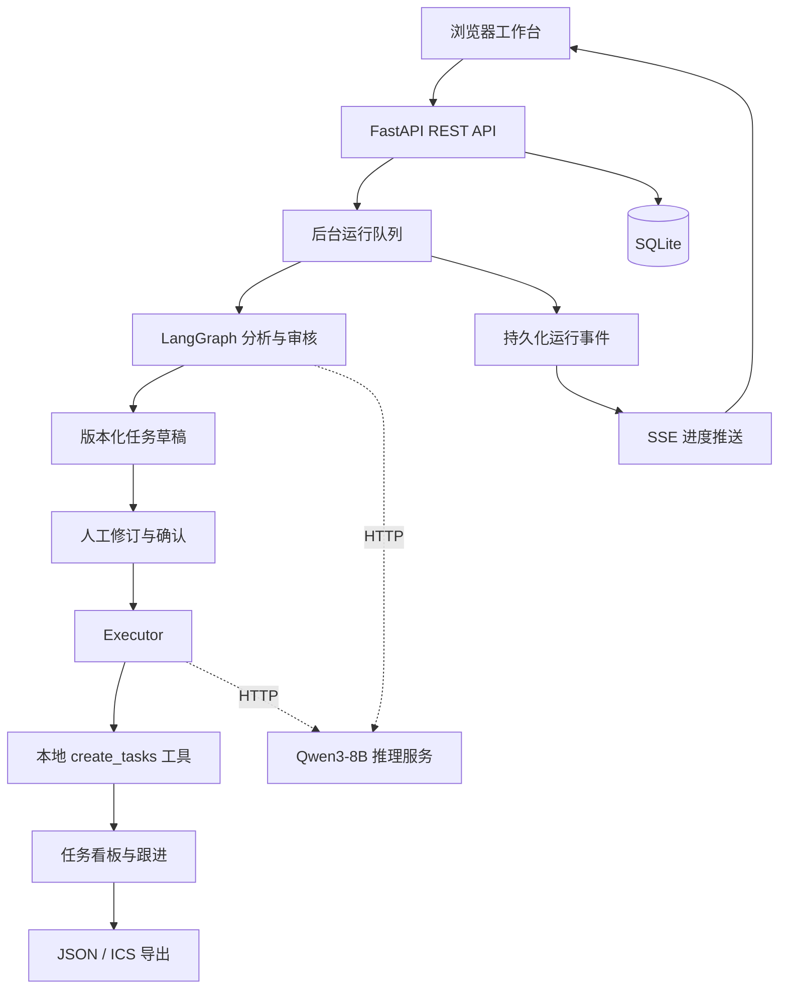

# 基于海光 DCU 的多 Agent 会议行动管理系统：从任务规划、人工审核到执行闭环

会议结束后，团队通常已经有了一份纪要，却未必有一份能够直接执行的任务清单。哪些讨论已经形成决议，谁负责交付，截止日期是什么，哪些事项仍需澄清，都需要再次人工整理。即使大模型能够生成一份看起来完整的计划，遗漏、推测和错误分配仍会影响后续执行。

围绕这一问题，我们实现了「序会 · Meeting Studio」：一个基于 FastAPI、LangGraph 和原生 JavaScript 的多 Agent 会议行动管理工作台。系统通过 OpenAI 兼容 HTTP 接口调用 Qwen3-8B，将会议理解、任务规划、语义审核和工具执行分配给四个角色，并将人工核验纳入正式流程。用户可以从会议原文出发，完成草稿审核、任务创建、状态跟进和日历导出。

本文介绍业务场景、多 Agent 协作机制、工程实现与复现方式。第四、五部分保留用于补充海光 DCU 的部署环境和性能实测。

## 一、场景与价值：让会议中的行动承诺进入执行流程

### 1.1 会议纪要到任务清单之间的缺口

一次项目会议往往同时包含进度同步、范围讨论、明确决议和未决问题。这些内容放在同一篇文本中，容易产生三类问题。

首先，行动承诺可能被摘要压缩掉。摘要保留了“完成登录模块”这一议题，却省略了接口联调、回归测试等具体工作。其次，讨论中的建议可能被误当成承诺。例如，“下次讨论验证码限流”并不意味着当前已经确定负责人和交付日期。最后，生成的任务缺少原文依据，使用者难以判断某个负责人或日期究竟来自会议，还是来自模型推测。

因此，系统需要同时保留会议上下文、任务依据和审核过程。只有用户能够核对这些信息，生成结果才有条件进入正式执行。

### 1.2 用一份具体会议定义预期结果

项目提供了 [登录模块迭代例会示例](examples/meeting.txt)，其中包含如下内容：

> 本轮先完成账号密码登录，第三方登录暂不纳入。张三负责在 2026-10-23 前完成登录接口联调，产出接口说明和联调报告。李四在联调完成后执行回归测试，截止日期为 2026-10-26，产出测试报告。验证码限流方案尚未确定，需要下次会议讨论，当前不分配负责人和截止日期。

根据原文，人工核对的预期任务如下。该表用于解释业务目标，不代表每次模型调用都会自动得到相同结果。

| 行动项 | 负责人 | 截止日期 | 交付物 | 依赖 |
|---|---|---|---|---|
| 完成登录接口联调 | 张三 | 2026-10-23 | 接口说明、联调报告 | 无 |
| 执行登录回归测试 | 李四 | 2026-10-26 | 测试报告 | 登录接口联调 |

“第三方登录暂不纳入”应作为范围约束保存；“验证码限流方案待讨论”应作为未决问题保留。它们不应被擅自转成已分配的执行任务。

这个例子说明，任务数量多、字段填满并不等于规划质量高。对明确承诺进行完整提取，同时保留未知信息，才符合会议管理的实际需要。

### 1.3 项目的应用定位

序会面向项目例会、需求评审和跨团队协调等文本会议场景。当前支持粘贴文本、上传 TXT 和文本型 PDF，处理链路为：

```text
会议输入 → 议题与决议提取 → 任务规划 → 自动审核 → 人工核验
         → 确认创建任务 → 看板跟进 → JSON / ICS 导出
```

项目的价值落在三个可检查的结果上：行动项能够回溯到原文；不确定信息能够显式保留并由人工处理；用户确认后的任务能够进入持久化看板，继续更新执行状态。

## 二、多 Agent 架构：围绕共享状态组织协作

### 2.1 应用层与推理层分离

系统将交互、业务流程和模型推理解耦。前端使用原生 HTML、CSS 和 ES modules，由 FastAPI 直接托管；后端负责会议解析、后台调度、流程编排、工具执行与 SQLite 持久化；独立模型服务通过 HTTP 提供推理能力。



这种分层使应用环境无需安装 CUDA 或 DCU 推理依赖。模型服务迁移时，应用侧主要调整连接地址、模型名称和鉴权，再检查目标接口的兼容性。硬件环境、推理框架与部署参数由推理服务侧管理。

### 2.2 四个角色各自承担什么责任

四个 Agent 是具有不同提示词、输入上下文和输出契约的逻辑角色，当前共享同一模型服务。

| 角色 | 输入 | 输出与职责边界 |
|---|---|---|
| Manager | 带编号段落的会议资料 | 提取摘要、议题、决议、约束和未决问题；决议关联原文 |
| Planner | 原文、会议分析、上一轮计划和审核反馈 | 生成任务、交付物、负责人、日期、依据与依赖；未知字段保留为空 |
| Reviewer | 原文、会议分析、任务计划和程序检查结果 | 检查遗漏、虚构、重复及语义依据；不直接修改草稿 |
| Executor | 用户已确认的草稿、工具目录 | 输出白名单工具调用指令；不重新生成任务内容 |

职责拆分让错误更容易定位。例如，任务遗漏可以追踪到规划输入与输出；审核误报可以检查 Reviewer 的依据；任务是否真正创建则由工具事务结果确认。

### 2.3 结构化状态如何在 Agent 之间传递

分析流程使用 LangGraph 的 `StateGraph` 实现，编排入口位于 [app/workflows/analysis.py](app/workflows/analysis.py)。共享状态包含以下字段：

```python
class AnalysisState(TypedDict, total=False):
    meeting: Meeting
    analysis: Analysis
    plan: Plan
    review: Review
    revision: int
```

Manager 写入 `analysis`，Planner 根据原文与分析生成 `plan`，Reviewer 生成 `review`。发生返工时，Planner 同时接收已有计划和审核反馈，对同一任务尽量保留稳定的 `local_id`，使依赖和问题引用能够继续对应。

这里采用进程内的状态传递与服务调用，没有引入独立消息中间件。SSE 承担浏览器进度推送，Agent 间的数据交换由 LangGraph 状态和结构化调用完成。两条通道分别服务于协作执行和用户观察。

### 2.4 有限返工，避免无限自我修正

初始分析顺序为 `Manager → Planner → Reviewer`。审核后，如果存在程序错误或语义审核意见，且未达到返工上限，流程返回 Planner；否则结束自动分析并保存结果。

源码中的条件路由为：

```python
def route(state):
    fixable = any(
        issue.severity == "error" or issue.origin == "reviewer"
        for issue in state["review"].issues
    )
    return "planner" if fixable and state["revision"] < max_revisions else END
```

默认 `PM_MAX_REVISIONS=2`，表示初始规划之后最多进行两次返工。仅有负责人或日期缺失等程序警告时，不反复要求模型补齐，以免把未知信息变成虚构信息。

达到返工上限表示自动尝试结束，草稿仍需依据当前审核状态进入人工核验。Executor 则在用户明确确认后，由独立执行服务调用，不接在自动分析图末尾直接执行。

角色提示词位于 [app/agents/prompts.py](app/agents/prompts.py)，三个分析角色的调用实现位于 [app/agents/meeting.py](app/agents/meeting.py)，Executor 的提示词和输出契约位于 [app/agents/executor.py](app/agents/executor.py)。

## 三、工程闭环：让不确定的生成结果经过可检查的执行门槛

### 3.1 为负责人和日期保留依据

会议文本经过解析后被划分为带编号的段落。任务通过 `source_refs` 关联原文，负责人和日期还分别携带字段依据。使用者因此可以检查某项分配由哪段原文支持。

系统区分两类依据：`document` 表示来自会议资料，`human` 表示会后人工补充并附有确认说明。Planner 不允许伪造人工确认依据；人工填写的字段也不能仅因原文缺少该信息就被当作虚构。

这一设计处理了真实会议中的常见情况：原文确实没有指定负责人，但项目经理会后已确认由某人承担。保留补充来源，比要求所有信息都“看起来来自原文”更符合实际工作流程。

### 3.2 将格式、确定性规则和语义审核分开

系统按不同问题采用不同检查方式。

**第一层是结构化输出校验。** 模型客户端优先提交 JSON Schema；遇到明确不支持该能力的服务响应时，回退到提示词约束并继续在应用端校验。输出清洗、JSON 解析和 Pydantic 契约检查共同处理格式问题，并通过有限修复、有限网络重试和整体超时控制等待时间。对于输出截断等情况，系统返回明确错误。

**第二层是程序规则。** [app/domain/validation.py](app/domain/validation.py) 检查原文引用是否存在、任务 ID 是否重复、字段是否缺少依据、依赖是否有效、是否存在自依赖或依赖环，以及前后置任务日期是否冲突。缺失负责人或日期等情况作为警告保留。

**第三层是 Reviewer 的语义检查。** 模型对照原文判断任务是否遗漏、描述是否歪曲、负责人或日期是否有语义依据。程序问题与模型意见分开保存，模型不能把程序硬错误降级或关闭。

需要注意，引用编号存在并不说明其语义足以支持任务；JSON 合法也不说明内容完整。分层检查让各类问题有明确处理位置，但最终仍需要人工核对。

### 3.3 面对遗漏和误报，保留人工处理路径

联调过程中，系统曾暴露出任务遗漏与 Reviewer 误报：原文包含行动承诺时，规划结果仍可能缺项；字段与原文一致时，审核仍可能提出缺少依据等意见。

针对遗漏，Planner 的提示词明确要求逐段检查原文，不能只根据 Manager 的摘要或决议列表生成任务；Reviewer 即使收到空计划，也需要检查原文是否有明确行动承诺。针对误报，审核提示词要求指出原文事实与草稿的具体差异，并明确不依据缺失的工时、日程等信息推测资源冲突。

这些约束有助于限定模型行为，但不能保证消除错误。因此，产品同时提供草稿编辑、版本历史、重新复核和逐项接受审核意见的能力。

| 问题类型 | 处理方式 |
|---|---|
| 引用无效、依赖环等程序硬错误 | 修改草稿，不能通过人工接受绕过 |
| 未知负责人或日期等程序警告 | 补充信息，或填写理由确认接受当前空值 |
| Reviewer 语义意见 | 核对原文后修正；确认是误报时附理由接受 |
| 模型未发现的遗漏 | 人工补充任务、记录必要依据，再重新复核 |

人工修改生成新的草稿版本。复核和执行请求都需要对应版本号，避免用户确认的内容与实际执行内容发生错位。`ready` 只表示草稿达到执行确认门槛；即使空计划通过检查，用户仍应检查原文中是否确实没有行动项。

### 3.4 让模型选择工具，由服务端绑定执行内容

用户明确确认当前草稿后，Executor 接收已确认草稿和工具目录，输出如下形式的指令：

```json
{
  "tool_name": "create_tasks",
  "arguments": {}
}
```

工具名称受契约和白名单限制，`arguments` 必须为空。任务内容、会议和运行上下文由服务端绑定，Executor 无需重新转述任务列表，也无法通过工具参数替换已经确认的内容。

当前 `create_tasks` 是应用内的本地工具，将任务写入 SQLite 并进入看板。它实现了会议输入到任务创建的应用内闭环；当前版本没有调用飞书、钉钉或其他外部平台，也没有自动发送日历邀请。

工具注册和执行机制分别位于 [app/tools/registry.py](app/tools/registry.py) 与 [app/services/execution.py](app/services/execution.py)。这一接口边界也为后续接入独立日历或看板服务提供了扩展位置。

### 3.5 在事务边界内处理版本、防重复与结果一致性

任务创建的核心逻辑位于 [app/repositories/tasks.py](app/repositories/tasks.py)。服务在准备执行时检查草稿版本与可执行状态，在真正写入任务的事务中再次验证执行上下文、草稿版本及硬规则。

正式任务、执行成功状态、草稿确认状态、工具调用结果和完成事件在同一事务中写入。写入失败时回滚，避免出现部分任务已创建而执行结果仍显示失败的状态。已成功执行的重复请求复用原执行记录，避免再次调用模型和重复创建任务。

事务提交之后，诊断文件写入失败也不会把已完成的任务误报为未执行。这样，用户看到的执行结论以业务数据提交结果为准。

### 3.6 用后台运行和诊断记录解释系统行为

模型调用可能持续较长时间，因此前端通过后台运行接口提交工作，服务返回 HTTP 202 和 Run 对象，再通过 SSE 接收阶段事件。事件持久化后，可使用 `Last-Event-ID` 或游标补读；关闭浏览器事件连接不会取消后台工作。

应用重启时，遗留的排队或运行记录会被标记为中断，用户可以按流程重试。当前调度采用单进程模式，没有实现重启后的自动续跑或分布式任务队列。

诊断产物按用途分开组织：

```text
test_artifacts/
├── api/          # 接口与端到端验证记录
├── llm/          # 提示词、Schema、请求、响应及解析结果
└── workflows/    # 角色输出、草稿、审核与执行上下文
```

排查时可以按 `run_id` 和 `trace_id` 对应业务运行与模型请求，判断问题发生在输入、生成、审核还是执行阶段。记录可能包含会议内容和模型原始响应，使用真实数据时需要管理访问权限与保留期限；模型及工作流跟踪可通过 `PM_LLM_TRACE_ENABLED` 关闭。

## 四、海光 DCU 部署：应用与推理服务解耦的适配路径

<!-- 本节由作者补充，当前留空。 -->

## 五、性能调优：资源调度、通信延迟与显存管理的实测

<!-- 本节由作者补充，当前留空。 -->

## 六、成果展示与复现：从源码到一条可检查的会议执行链路

### 6.1 项目交付内容与源码入口

项目包含前后端完整代码、Agent 编排与提示词、示例会议、运行脚本、自动化测试，以及 [README](README.md) 源码说明。核心目录如下：

| 位置 | 内容 |
|---|---|
| [app/web/](app/web/) | 原生前端页面、样式和 JavaScript 模块 |
| [app/api/](app/api/) | REST 接口、SSE 与页面入口 |
| [app/workflows/analysis.py](app/workflows/analysis.py) | Agent 分析编排、状态与条件路由 |
| [app/agents/](app/agents/) | 角色提示词、调用实现与输出契约 |
| [app/domain/](app/domain/) | 数据契约、状态与程序校验 |
| [app/services/](app/services/) | 业务编排、后台调度和执行服务 |
| [app/tools/](app/tools/) | 受限工具注册及调用机制 |
| [app/repositories/](app/repositories/) | SQLite 持久化与任务创建事务 |
| [tests/](tests/) | 后端测试与前端模块行为测试 |
| [scripts/](scripts/) | 应用启动与接口验证脚本 |

**公开源码仓库链接：待发布时填写。**

公开发布时还需注明用于复现的提交或发布标签，并附上《基于海光DCU的多智能体协同部署与调优指南》。第四、五部分的部署与实测内容完成后，可整理为这份独立交付文档，与源码共同提供。

### 6.2 应用启动与远程访问

模型推理环境与应用环境分开准备。在项目根目录，使用 Python 3.10 或以上版本安装应用依赖；已有 `demo1` 环境时，可直接激活使用。

```bash
conda activate demo1
python -m pip install -r requirements.txt
cp .env.example .env
```

在 `.env` 中配置实际可访问的模型服务。以下为模型与应用位于同一主机、模型端口为 8000 时的示例：

```dotenv
PM_LLM_BASE_URL=http://127.0.0.1:8000/v1
PM_LLM_MODEL=qwen3-8b
PM_LLM_API_KEY=EMPTY
```

模型位于另一台服务器时，将地址替换为应用能够访问的服务地址，并按实际配置鉴权。应用连接模型 HTTP 接口，具体 DCU 推理环境与启动方法由第四部分补充。

启动工作台：

```bash
bash scripts/run.sh
```

默认访问地址为 `http://127.0.0.1:8080/`，接口文档为 `http://127.0.0.1:8080/docs`。`/api/health` 用于检查应用状态，`/api/model/health` 用于检查模型列表接口及配置的模型名称；后者不替代实际生成和完整工作流验证。

服务器没有浏览器时，可以在本地电脑建立 SSH 端口转发：

```bash
ssh -N -L 18080:127.0.0.1:8080 user@server
```

随后在本地浏览器打开 `http://127.0.0.1:18080/`。也可以使用 VS Code Remote 的端口转发功能。

### 6.3 演示一条完整业务路径

以示例会议为输入，演示从原文到正式任务的全过程，可以同时检查功能与执行边界。

1. **导入会议。** 填写日期和时区，粘贴纪要或上传文件，查看保存后的原文段落。
2. **运行分析。** 观察 Manager、Planner、Reviewer 的阶段事件及返工情况，等待草稿保存。
3. **人工核验。** 对照原文检查两项明确行动是否完整提取、未决事项是否正确保留；必要时编辑草稿并复核。
4. **处理意见。** 修正实际问题，对已核实的误报或可接受警告附理由处理。
5. **确认执行。** 核对当前版本并明确确认，检查工具返回及正式任务数量。
6. **跟进与导出。** 在看板更新任务状态，查看跟进报告，下载 JSON 与 ICS 文件。

展示材料可以选择三组页面：会议原文与分析进度、带依据的草稿与审核意见、正式看板与导出结果。截图和录像应来自实际运行，保留必要的人工处理过程，使评阅者能够理解系统的真实行为。

正式任务支持 `todo`、`in_progress`、`done` 三种状态。跟进报告按会议时区统计到期与逾期信息。ICS 将已执行任务中具有明确截止日期的事项导出为全天日历事件；没有日期的任务会跳过并提示数量，JSON 则用于查看和保存结构化快照。

### 6.4 分开验证业务正确性与模型质量

项目的验证分为无需真实模型的回归测试，以及需要模型服务的接口与工作流验证。

```bash
python -m pytest -q
```

回归测试覆盖文档解析、数据契约、模型响应处理、规划与人工审核、任务事务、后台运行、导出和 Web 接口等逻辑。存在 Node.js 时，pytest 还会调用前端模块行为测试；也可以单独运行：

```bash
node --test tests/frontend/*.test.mjs
```

真实接口验证脚本提供模型、规划、执行、后台运行和导出等入口，例如：

```bash
python scripts/smoke_model.py
python scripts/smoke_planning.py
python scripts/smoke_execution.py
python scripts/smoke_runs.py
python scripts/smoke_exports.py
```

脚本使用隔离数据库和诊断目录，详细记录组织方式见 [测试产物说明](test_artifacts/README.md)。接口链路通过说明预定流程可以完成，不能据此推导真实会议提取准确率；Node 模块测试也不替代浏览器视觉和交互验证。

模型质量需要结合人工参考任务评估，包括行动项遗漏、无依据任务、负责人和日期正确性，以及审核误报等。DCU 性能数据则应与会议规模、调用次数和返工次数一起记录，具体结果由第五部分补充。

### 6.5 当前边界与后续演进

当前版本适合单实例部署与受控环境中的会议行动管理验证：应用使用一个 Uvicorn worker 和 SQLite，本地保存业务数据，支持文本输入与应用内任务执行。尚未提供应用层账号认证、多租户隔离、音频转写、扫描件 OCR 或外部办公平台同步。执行后主要开放任务状态更新，依赖信息不会自动阻止人工切换状态。

后续演进可以围绕真实使用反馈展开：积累脱敏会议及人工参考任务，评估遗漏与误报；扩展独立日历或看板工具，并补充外部请求的授权和幂等机制；在多用户需求明确后，再引入认证、权限隔离及适合多实例的调度与存储方案。

这套实现将模型生成、人工判断和程序执行分别放在适合的位置：模型负责理解和提出计划，用户核实业务事实与执行意愿，程序校验和事务机制保证已确认内容按约束进入任务系统。各阶段的结果与依据都能够回溯，为后续部署评估、问题排查和持续改进提供基础。
